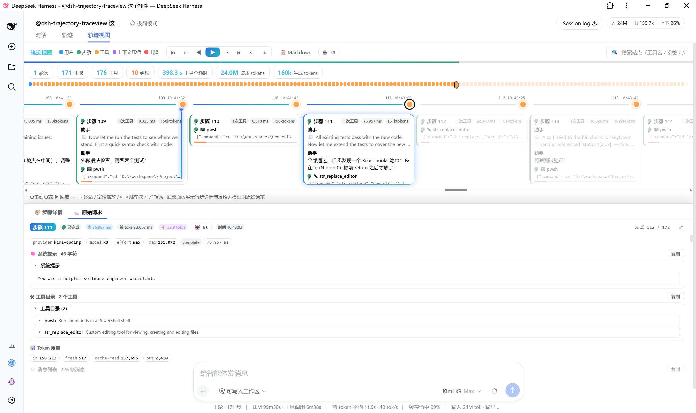

# 轨迹视图 · Trace View

<div align="center">
  <a href="README.md">中文</a> · <b>English</b>
</div>

> **Render the AI execution flow of a DeepSeek Harness Web GUI session as a replayable, horizontal timeline — every step's actions and every raw request sent to the model, laid out in front of you.**
> Built for learning and tuning prompts: wondering why the AI answered that way? Open Trace View to see what it reasoned about, which tools it called, what results it got, and the actual message payload it saw at the time.

**Version baseline**: forked from upstream `v0.3.0` (commit `2d1d07d`, 2026-08-26). Upstream has not released since (three commits in total). This repository has evolved independently from `0.4.0`, so **the version numbers are no longer comparable to upstream** — do not read `0.9.x` as an upstream version. Per-file and per-function provenance lives in [`docs/PROVENANCE.md`](docs/PROVENANCE.md) (auto-generated). Versioning rules: [§11](#11-versioning).

> **This is the Plus edition, not upstream.** Built on [AFAP/dsh-trajectory-traceview](https://github.com/AFAP/dsh-trajectory-traceview) (MIT): every upstream capability is kept, plus stable anchors, orphan tool-result stations, inline durations, a clock axis, and an explicit search-scope badge. **Do not install both** (you would get two "Trace View" tabs) — run `dsh plugin --profile web remove dsh-trajectory-traceview` first.

[](LICENSE)
[](https://github.com/MisonL/dsh-trajectory-traceview-plus/releases)

---

## 1. The problem it solves

Reconstructing "how did the AI actually execute this session?" with the built-in trajectory tab means flipping through a bare event list; and "what exactly was sent to the model for that request?" (system prompt, tool catalog, rebuilt messages) is invisible — the data lives in the session's internal state with no picture to look at.

This plugin adds a "**Trace View**" tab right next to the "轨迹" tab, rendering the same session state as an **interactive, searchable, exportable horizontal timeline**:

```
session trajectory (views.get("trajectory") snapshot — reuses official data as-is)
  │
  ├─ top minimap: time-ordered station blocks, click to jump
  ├─ horizontal timeline: real wall-clock labels, ◀ ▶ step-by-step replay
  ├─ bottom [Step Detail]: reasoning / tool args / full results / sub-calls / timings
  ├─ bottom [Raw Request]: the full context sent to the model for that step (prompt study)
  └─ header KPIs: turns / steps / tools / errors / duration / tokens + 📋 one-click Markdown
```

**Read-only**: it only re-renders the `TrajectorySnapshot` the session view has already produced; no file is modified, no network is touched, and the host half is a no-op stub.

## 2. Features

Each item is tagged **〔upstream〕** (present in upstream v0.3.0) or **〔Plus〕** (added or changed here).

### Flow overview

- ✅ 〔upstream〕 Horizontal timeline + top **minimap**: one color block per station (user=blue / step=green / tool=orange / compaction=purple / error=red / retry=yellow / command=cyan); click a block to jump instantly; the current station is highlighted during replay.
- ✅ 〔upstream〕 Full event stream: user messages, assistant steps, tool calls, **context compaction**, **turn failures**, **model retries**, **max-output cutoffs** and **commands** all land on the timeline in time order; compaction / command events are pinned to their owning turn by `seq`.
- ✅ 〔upstream〕 KPI bar: turns / steps / tool count / errors / total tool time / request & generation tokens, a live "current step" indicator, and the active model name.
- ✅ 〔upstream〕 Stations are labeled with **real wall-clock time** (not event indexes).

### Finding what you want

- ✅ 〔upstream〕 🔍 **Search**: filter stations by tool name / args / body text / error name; hits get a gold outline plus a minimap highlight; `Enter` / `Shift+Enter` or `↑` `↓` step through hits; `/` or `f` focuses the search box, `Esc` clears.
- ✅ 〔upstream〕 **⇤ / ⇥ turn jumps** (PageUp / PageDown): hop between turn start points.
- ✅ 〔upstream〕 **⇣ follow mode**: while the AI is working, new stations auto-scroll into view; any manual navigation pauses following, ⏭ "show all" resumes it.
- ✅ 〔upstream〕 **Inspect deep-link contract**: implements the session view's `inspect` protocol — if a tool-inspection request arrives while this tab is active, it locates the station containing that call.
- ✅ 〔upstream〕 **⬆ load older history**: one-click paging for events outside the long-session window (reuses the session's `hasMore` / `loadOlder`).
- ✅ 〔upstream〕 **Explicit search scope** (Plus): search only covers the **currently loaded** trace, so the hit counter carries a `⬆ loaded range only` badge — click it to page in one more chunk, and the newly loaded stations join the search immediately. Unloaded history is **never** reported as "no match".

### Locatable, copyable stations (Plus)

- ✅ 〔Plus〕 🔗 **Stable anchors**: every station has a copyable reference (🔗 in the detail header) such as `tvp1:e3019`. Paste it into the 🔗 box in the toolbar and press Enter; **the address bar mirrors it as `#tvp1:e3019`**, so the link survives a reload and can be shared.
- ✅ 〔Plus〕 **Cross-page locating**: when the target sits in unloaded history, older pages are pulled automatically until it appears (page-bounded; on hitting the cap it says "not in the loaded window" instead of pretending to succeed).
- ✅ 〔Plus〕 **Honest about synthetic records**: records that are not yet durable (an interrupted assistant message, a tool call cut off mid-flight) get a `tvp1:p3s7`-style anchor and are explicitly marked "not persisted, not deep-linkable" instead of handing out a link that dies on reload.
- ✅ 〔Plus〕 **Orphan tool results still appear**: a `ToolResultNode` whose assistant header fell outside the window (`call === null`) is no longer lost — it becomes its own `orphan-tool` station, searchable and locatable like any other.

### Time you can actually see (Plus)

- ✅ 〔Plus〕 **Inline start/end times**: each step card shows `14:24:21 → 14:24:53` directly — no hover, no detail panel.
- ✅ 〔Plus〕 **Honest duration provenance**: "has timing" / "no timing recorded" / "partial timing" are three distinct states — a missing record is never rendered as 0.
- ✅ 〔Plus〕 **Idle bands**: gaps longer than 30 s between two actions are labeled on the rail (`⏸ 47,628 ms`), answering "what were those 4 hours spent on".
- ✅ 〔Plus〕 **⏱ even / clock toggle**: even spacing for reading, clock mode scales idle bands logarithmically so long waits are visible at a glance.

### What each step did (bottom "Step Detail")

- ✅ 〔upstream〕 Assistant output text and 💭 reasoning content (collapsible).
- ✅ 〔upstream〕 Every tool call: args (formatted JSON), **full tool result**, a **complete sub-call card** (each sub-call's own args / result / duration / error), a duration bar, and the error code.
- ✅ 〔upstream〕 Step-level metadata: ⏱ total step duration, time-to-first-token (TTFT), ⚡ decode throughput tok/s, token usage, and a "stopped" interruption flag.
- ✅ 〔upstream〕 The detail panel can be ⤢ expanded to full height / ⤡ collapsed.

### Raw request (bottom "Raw Request" tab, shortcut `r`)

- ✅ 〔upstream〕 **Model config**: provider / model / temperature / reasoningEffort / thinking / maxTokens / stop / status / duration / retry info.
- ✅ 〔upstream〕 **⚡ Prompt diff**: what changed versus the previous request — system-prompt character delta and `+ added` / `- removed` tool names (`initial` = the first system prompt).
- ✅ 〔upstream〕 **Full system prompt**: character count + one-click copy (includes the tool-catalog JSON).
- ✅ 〔upstream〕 **Tool catalog**: every tool schema carried by that request, expanded one by one; copyable.
- ✅ 〔upstream〕 **Message list**: the model-visible messages **approximately rebuilt** from the session log (user / assistant / tool results, with compaction markers), each expandable in full; the whole request payload JSON is copyable. It is rebuilt **only while this tab is open** (lazy — long sessions stay snappy).
- ✅ 〔upstream〕 **Token usage**: inbound (incl. cache reads / writes) and outbound (incl. thinking) breakdown.
- ✅ 〔upstream〕 **Context-compaction stations** have their own "Raw Request" too: the compaction request's model / duration / usage plus the **full compaction output**.

### Export study notes

- ✅ 〔upstream〕 Header **📋 Markdown**: one click copies the whole trace as Markdown — each step's reasoning / text / tool args / results and a per-step request-config summary, plus an appendix with the first request's system prompt and tool catalog.

## 3. Preview

| Trace View overview (timeline + minimap + bottom detail / raw-request panels) |
|:---:|
|  |

## 4. Directory layout

```
dsh-trajectory-traceview-plus/   # repo root (directory name == npm package name)
├── package.json          # dsh.bundle.patch + dsh.client (browser declaration) + exports["./client"]
├── package-lock.json     # for CI's npm ci only (not in the published files list)
├── cordis.patch.yml      # composition row: a single plugin record (no route, no config)
├── LICENSE               # MIT
├── CHANGELOG.md          # release record (version-check verifies the entry)
├── screenshot/           # screenshots for the README "Preview" section
├── .github/workflows/
│   └── check.yml         # CI: the eight gates, in the same order as the local commands
├── src/                  # browser source (lib/client.js is generated from it; never hand-edit)
├── scripts/
│   ├── build-client.mjs  # src/ -> lib/client.js
│   ├── provenance.mjs    # generates docs/PROVENANCE.md
│   ├── version-check.mjs # version / tag / CHANGELOG agreement
│   ├── doc-ref-check.mjs # DESIGN.md §x.y references resolve
│   ├── doc-heading-check.mjs # headings must be valid Markdown (space after #)
│   ├── readme-numbers.mjs # README numbers match the code (computed, not typed)
│   ├── release-status.mjs # tag / Release / npm metadata / tarball / @latest resolution (network; not in CI)
│   ├── guard-check.mjs   # feed the P1 growth guard known complexities; does it still tell them apart? (timing; not in CI)
│   ├── shortcut-check.mjs # every key in README §7 must be exercised by the probe (in CI)
│   ├── browser-check.mjs # real-browser assertions (needs agent-browser)
│   └── browser-harness.mjs / bench-fold.mjs
├── docs/                 # DESIGN.md (why each change) / PROVENANCE.md (generated)
├── test/
│   ├── smoke.test.cjs    # helper unit tests (plain node)
│   └── browser/          # fixture.js (host stub) / probe.js + probe-detail.js (interaction / state)
│                        #   probe-en.js (English UI)
│                        #   harness.html is generated by browser-harness.mjs and not committed
└── lib/
    ├── index.js          # host half: no-op stub (browser-only plugin)
    └── client.js         # browser bundle: the trace view (generated)
```

## 5. Quick start

Install from npm (recommended — **pin the exact version**):

```powershell
dsh plugin --profile web add dsh-trajectory-traceview-plus@0.11.5
```

> **Why not `@latest`**: `dsh plugin` forwards to pnpm, and **pnpm 12 ships a supply-chain delay** (`minimumReleaseAge`, default **1440 minutes = 24 hours**): a version published less than a day ago is not selected by `@latest`, and pnpm **silently falls back to the previous release** — no warning at all. Right after 0.11.0 was published, `pnpm add pkg@latest` installed 0.10.0, which the newer DSH hosts skip entirely. An exact version has no such ambiguity (verified with both cold and warm caches).
>
> The boundary was measured: `--config.minimumReleaseAge=300` (5 h) still resolves the new version, `1440` resolves back to the old one; the default has been `1440` since pnpm v11 ([docs](https://pnpm.io/settings/dependency-resolution#minimumreleaseage)). In other words, **during the first day after anyone publishes, `@latest` hands out the previous release** — that is the package manager's supply-chain policy, not a bug in this plugin.
>
> Related: this package's early `0.0.0-stage` has malformed metadata (no `size` field), so resolving `@latest` against a cold cache fails outright (`numeric field was not a number`). Pinning the version avoids that path.

Install from GitHub (**always pin the tag**):

```powershell
dsh plugin --profile web add "github:MisonL/dsh-trajectory-traceview-plus#v0.11.5"
```

> **Why the `#v0.11.5` matters**: a `github:` spec without a ref installs the **default branch HEAD**, not any released version. This repository keeps committing after a release (v0.11.0 was followed by five docs/scripts commits), so an unpinned install can hand you different code tomorrow while still reporting version 0.11.0. Pinning the tag is what makes "installed" and "released" the same code.

Then **restart `dsh web`** to take effect.

> After installation the plugin lives at `$DSH_HOME\profiles\web\node_modules\dsh-trajectory-traceview-plus` (cloned by pnpm from GitHub), independent of the source checkout location.

Upgrade:

```powershell
dsh plugin --profile web update dsh-trajectory-traceview-plus
```

Uninstall:

```powershell
dsh plugin --profile web remove dsh-trajectory-traceview-plus
```

### Manual install from a source directory (for equivalent verification)

```powershell
dsh plugin --profile web add "G:\path\to\dsh-trajectory-traceview-plus"
```

### Verify it loaded

Open any session with an AI execution trace → a "Trace View" tab appears next to the built-in trajectory tab → clicking it shows the horizontal timeline and minimap.

## 6. Usage

1. Open any session that has an AI execution trace.
2. Click the "Trace View" tab: the minimap at the top thumbnails every station; the timeline below is ordered by real wall-clock time.
3. **Browse / replay**: ◀ ▶ or the arrow keys step through stations; ▶ auto-replays (×1 / ×2 / ×4 speeds); Space toggles play / pause.
4. **Search**: press `/` to focus the search box, type a tool name / arg / body text / error name, and press Enter to hop between hits.
5. **Select any assistant step**: the bottom "Step Detail" shows its reasoning, text and every tool call's args / results / sub-calls / timing; switch to the "Raw Request" tab (`r`) to study the full context that request sent to the model.
6. **Export notes**: click the 📋 header button to copy the whole trace as Markdown.
7. **Long sessions**: click ⬆ to load older history; switch on ⇣ follow mode while the AI is working.

## 7. Shortcuts

| Key | Action |
|---|---|
| `←` / `→` | previous / next station |
| `Home` | jump to the first station (and select it) |
| `End` | show all: back to the overview with nothing selected (NOT "jump to the last station") ¹ |
| `Space` | play / pause replay |
| `PageUp` / `PageDown` | previous / next turn start |
| `/` or `f` | focus the search box |
| `↑` / `↓` (searching) | previous / next search hit |
| `Enter` / `Shift+Enter` (searching) | next / previous hit |
| `Esc` | clear search / dismiss |
| `r` | toggle the "Raw Request" panel |

¹ `End` means different things depending on what has focus — two separate handlers, not two names for one key:

| Focus on | `End` does | Selection |
|---|---|---|
| the panel root | show all, back to the overview | cleared |
| a station card | jump to the last station (listbox convention) | **unchanged** (focus only) |
| a text field (search, anchor) | the panel does not handle it; the browser moves the caret | unchanged |

All three are asserted by the keyboard group in `probe.js`.

## 8. Implementation notes (data sources)

| Concern | Approach |
|---|---|
| Data source | Reuses ONLY the `views.get("trajectory")` snapshot (`TrajectorySnapshot`) of the DSH Web session state: `eventNodes` (with `timing` / `usage` / `provenance` / `interrupted`), `requests` (assistant + compaction requests), `callSchemas` (tool schemas at call time), `partial` / `runningCalls` (live streaming state), plus the session-level `hasMore` / `loadOlder` paging. |
| Raw request | The "message list" is an **approximately rebuilt** payload from the session log (the original messages array is not snapshotted); the panel marks it "approximate" — precise enough for prompt study. |
| Laziness | The message list is rebuilt only when the "Raw Request" tab is opened — long sessions stay responsive. |
| Mounting | Registers the new tab beside the session view's built-in trajectory tab via `dsh.client.inject` (`dsh-client-runtime` / `dsh-client-locale` / `dsh-client-ui-conversation`). |
| Deep link | Implements the session view's `inspect` protocol: when a tool-inspection request arrives, it locates the station containing that call. |

## 9. Troubleshooting

| Symptom | Where to look |
|---|---|
| "Trace View" tab missing | Confirm `dsh web` was restarted; search F12 Console for `dsh-trajectory-traceview-plus`. |
| Timeline empty / no stations | The session needs an AI execution trace (user message → assistant steps); brand-new sessions show the empty-state hint. |
| Search finds nothing | The search term must match a tool name / arg / body text / error name. |
| Message list differs from the real request | The list is an approximate rebuild (the original messages array is not snapshotted) — the panel marks this; treat the system prompt and tool catalog as authoritative. |
| Old sessions feel slow | Only opening the "Raw Request" tab rebuilds the message list; plain timeline browsing is unaffected. |

## 10. Security & compliance

- **Read-only**: only renders the `TrajectorySnapshot` the session view already produced; no business-DOM mutation, no file modification or deletion, no host route, no network access.
- **Local data**: everything is processed inside the browser; the raw request is rebuilt only when you open its panel, and nothing is ever uploaded anywhere.
- **The one write: two pieces of view state in `sessionStorage`.** So that a host remount does not drop you back to "overview with an empty search box", each conversation gets one entry `dstv:view:1:<sessionKey>` holding `{ revealed, query }` — how far the window was expanded (a number) and the search text (≤200 chars).
  - **This tab only** (sessionStorage, not localStorage): never shared across tabs or windows, gone when the tab closes.
  - **Removed, not blanked**: when both fields are empty the key is deleted rather than left behind.
  - **Works with storage disabled**: every access is inside `try/catch`, so a host that blocks storage behaves exactly as before and never throws.
  - Note: the search box text is part of that entry — **if you typed something sensitive into the search box it stays in this tab's sessionStorage** until the tab closes or the query is cleared.
- **No persistence**: nothing written to localStorage / cookies / IndexedDB; no server, no telemetry; uninstalling leaves no trace.

## 11. Development & build

Plain JS, and nothing is bundled at runtime — but **`lib/client.js` is a generated file**. Edit `src/*.js` and rebuild; never hand-edit `lib/client.js`:

```powershell
node scripts/build-client.mjs
node scripts/build-client.mjs --check
node scripts/provenance.mjs
```

Editing `src/` without rebuilding makes `--check` fail and the smoke suite report `BUILD1`. `lib/index.js` (host half) is a no-op stub; `lib/client.js` is a classic script (`window.__ModuleLoader__.load`) served directly by the client module system.

```powershell
npm run check              # 10 steps: build --check / provenance --check / version-check / doc-ref-check
                           #           doc-heading-check / smoke / readme-numbers / shortcut-check / harness-stamp / path-leak-check
npm test                   # smoke only
```

The tests run the helper region against mock snapshots covering: tree building / request attachment / compaction-request pairing / sub-call detail / prompt diff / step timing / search matching / Markdown export / token stats.

**What needs a real browser** (`react-dom/server` cannot see scroll, focus, clipboard, intervals or layout):

```powershell
node scripts/browser-check.mjs          # builds the harness; 288 assertions over 43 recorded groups
node scripts/browser-check.mjs --shots  # saves screenshots and adds 1 more group / 3 assertions: 375px overflow (44 total)
```

It needs `agent-browser` (Chrome via CDP). **Deliberately not in CI**: adding a browser to the runner is more moving parts than the check is worth, and a flaky browser job trains people to ignore red builds. Run it locally before releasing.

Other scripts: `scripts/bench-fold.mjs` times the pure fold that the streaming path repeats; `scripts/browser-harness.mjs` builds the standalone harness page (`test/browser/harness.html`) normally invoked by `browser-check`.

## 12. Compatibility and data contract

This plugin reads the official trajectory snapshot (`eventNodes` / `requests` / `callSchemas` / `partial` / `runningCalls`). Because that snapshot comes from another plugin and the contract is not ours, there are two explicit promises:

- **Malformed data never crashes the page**: `null`, wrong types and missing fields are skipped with an explicit `⚠ N record(s) malformed` notice.
- **Version drift is stated loudly**: if a DSH upgrade renames fields or node kinds, the header shows `⚠ N record(s) not recognized [kinds]`; if *nothing* is recognizable you get "Cannot recognize this session's trajectory data" with reason codes — **never a silent "no data yet" or a plausible-looking partial trace**.
- **The host is never accused wrongly**: `kind: "unknown"` is a *named* node kind in the contract (the host saying "I do not model this event"), so it renders as a first-class station carrying the event type and its raw payload, and it is **not** counted as drift. Only genuinely unseen kinds raise the alarm — one exotic event must not make the whole tree claim the format is unrecognized.

`engines.dsh` is `>=0.2.2-rc.2 <0.2.3-0` — it covers **only the 0.2.2 line that was actually tested**, and stops at the minor boundary. Earlier hard-pin conclusions (`=0.2.1-rc.5`, `=0.2.2-rc.2`) are kept in `docs/DESIGN.md` §12.25–§12.27 and §13.43.

**DSH *skips* an unmatched plugin** at boot (`skipping profile bundle … requirements {"engines.dsh":…}`) instead of degrading it, so getting the requirement wrong makes the whole tab vanish.

**Why a range instead of a hard pin**: the hard pin's cost came due on 0.2.2-rc.5 — the host moved one patch version and the tab vanished, though nothing in the plugin was broken. A range means patch releases inside the same minor no longer require a matching plugin release.

**Why the range stops at the minor boundary**: the ceiling is `<0.2.3-0`, not `<0.3.0`. Declaring compatibility is declaring *tested*; 0.2.3 has not been tested, so it is not claimed. On a new minor the plugin is skipped again, which is the signal to re-verify and cut a release — **being skipped is a clear signal, and far better than silently degrading**. To unblock temporarily, use the host's exact-version exemption:

```bash
dsh plugin allow-version        # interactive; see dsh plugin --help
```

The host prints the exact command in the skip warning.

## 13. License

MIT. Upstream © [AFAP](https://github.com/AFAP/dsh-trajectory-traceview); this Plus edition is a derivative of v0.3.0, released under the same MIT terms with the original copyright notice kept.

Substantive changes versus upstream: stable anchors and deep-link parsing, orphan tool-result stations, inline step start/end with three-state duration provenance, idle bands and the clock axis, search-scope badge, and package/view ids renamed to `-plus` / `traceview-plus` (order 21) so the two never collide.

---

> **Disclaimer**: This plugin is a local learning / debugging tool. The authors are not responsible for any decision made based on trace data (including approximately rebuilt message payloads); please don't share session traces containing sensitive content on shared / multi-user screens.
## 14. Versioning

**Baseline**: forked from upstream `v0.3.0` (commit `2d1d07d`, 2026-08-26); upstream has not published since. This repo has evolved independently from `0.4.0`.

**Numbering** — the second digit tells you whether you must upgrade alongside the host:

| Change | Position | Example |
| --- | --- | --- |
| `engines.dsh` moves (re-pin or widen to a range) | **minor** | `0.7.0 → 0.8.0` for DSH 0.2.2; `0.10.0 → 0.11.0` for the range |
| New capability, or changed behaviour | **minor** | `0.8.2 → 0.9.0` light theme + a11y |
| Fixes, performance, copy, docs | **patch** | `0.8.1 → 0.8.2` |
| Breaking (anchor format, view id, config) | **major** | none yet |

`engines.dsh` covers only the current minor, so a host minor bump still requires a matching plugin release. That is one reason the number moves fastest — it is not feature bloat.

**Release steps** — every one of them, in order (skipping `npm publish` is what §13.47 records):

```bash
# 1-3 edit files: package.json version, CHANGELOG.md entry
node scripts/provenance.mjs              # 4. refresh the provenance list (rerun after any add/rename)
npm run check                            # 5. the 7 local gates; all green before going further
git add -A; git commit -m "..."          # 6.
git push origin main                     # 7.
git tag -a v0.11.5 -m "..."              # 8.
git push origin v0.11.5                  # 9.
npm publish                              # 10. runs prepublishOnly -> the whole check again
gh release create v0.11.5 --notes-file … # 11. the badge reads the Release, not the tag

node scripts/release-status.mjs          # 12. do all four agree? (tag / Release / npm metadata / tarball)
```

**Step 10 is the easiest to miss and it fails silently.** After `git push` and `git tag` the repo looks "released" — but the registry still serves the old version, so `npm i <name>@latest` hands people the old package. That happened here once: tag and Release both present, npm still on the previous release (§13.47).

**Step 11 is not ceremony**: the version badge at the top of the page reads the GitHub **Release**, not the tag. Tagging without creating a Release makes the badge show a red `no releases`, which reads as an abandoned repo (§13.45).

Three things guard the release, and all live in CI (`.github/workflows/check.yml`) so they run on every push to `main` and every pull request:

- stale `docs/PROVENANCE.md` — the smoke suite fails (`V1`)
- version / tag disagreement — `node scripts/version-check.mjs` fails (`F1`)
- a missing `CHANGELOG.md` entry for the version (`F2`), or a version that goes backwards relative to an existing tag (`F3`)

CI runs those 9 gates plus an install step (`npm ci --include=dev`): `build-client --check`, `node --check lib/client.js`, `provenance --check`, `version-check`, `doc-ref-check`, `doc-heading-check`, smoke, readme-numbers, shortcut-check, harness-stamp. `npm run check` runs 10 of them locally (build, provenance, version-check, doc-ref-check, doc-heading-check, smoke, readme-numbers, shortcut-check, harness-stamp, path-leak-check) — everything but `node --check lib/client.js`; run `browser-check` too before releasing — see §11.

**Those numbers have a gate of their own**: `readme-numbers` derives the true values from `check.yml`, `package.json` and `test/browser/probe.js`, then checks both READMEs against them. A number written down twice will eventually disagree with itself (§13.37).
