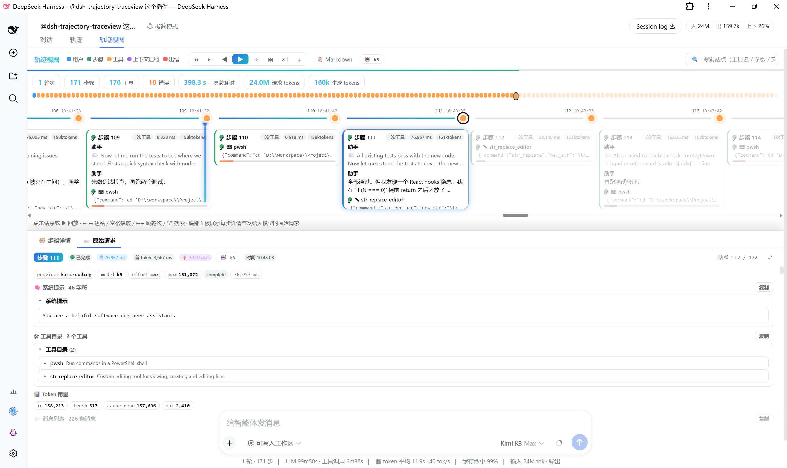

# 轨迹视图 · Trace View

<div align="center">
  <b>中文</b> · <a href="README.en.md">English</a>
</div>

> **把 DeepSeek Harness Web GUI 会话里 AI 的执行过程渲染成一条可回放的横向时间轴——每一步做了什么、每次发给大模型的原始请求都摊开在眼前。**
> 专为「学习与调优提示词」设计：想弄清 AI 为什么这么回答？打开轨迹视图，看它思考了什么、调用了哪些工具、拿到了什么结果，以及它当时真正"看到"的消息载荷。

> **这是增强版（Plus），不是上游原版。** 基于 [AFAP/dsh-trajectory-traceview](https://github.com/AFAP/dsh-trajectory-traceview)（MIT）改造：保留原版全部能力，新增稳定锚点、孤立工具结果站点、行内耗时、时钟轴、检索范围标注等。**与原版不要同时安装**（会出现两个「轨迹视图」标签），先 `dsh plugin --profile web remove dsh-trajectory-traceview`，再装本包。

**版本基线**：分叉自上游 `v0.3.0`（commit `2d1d07d`，2026-08-26）。上游此后未再更新（仓库共 3 个提交）。本仓从 `0.4.0` 起自主演进，**版本号与上游不再对齐**——不要拿本仓的 `0.9.x` 去推断上游版本。版本规则见 [§11](#11-版本与发布规则)。

[](LICENSE)
[](https://github.com/MisonL/dsh-trajectory-traceview-plus/releases)

---

## 1. 它解决了什么问题

长会话里想还原「AI 当时是怎么执行的」，内置轨迹标签只能逐条翻事件列表；想看「某次请求到底把什么发给了大模型」（系统提示、工具目录、重建消息）更是无从下手——这些数据散落在会话内部状态里，没有画面。

本插件在「轨迹」标签右侧新增一个「**轨迹视图**」标签，把同一份会话状态渲染成**可回放、可搜索、可导出的横向时间轴**：

```
会话轨迹（views.get("trajectory") 快照，官方数据完全复用）
  │
  ├─ 顶部 minimap：按时间序的站点色块，点击秒跳
  ├─ 横向时间轴：真实时钟时间标注，◀ ▶ 逐站回放
  ├─ 底部【步骤详情】：思考 / 工具参数 / 结果全文 / 子调用链 / 耗时
  ├─ 底部【原始请求】：该步骤当次发给大模型的完整上下文（提示词学习）
  └─ 头部 KPI：轮次 / 步骤 / 工具 / 错误 / 耗时 / tokens + 📋 一键 Markdown
```

**只读**：只读取会话视图里已生成好的 `TrajectorySnapshot` 快照并重新渲染；不修改任何文件、不访问网络，宿主半部是无操作桩。

## 2. 功能特性

每个条形目标注来源：**〔原版〕** = 上游 v0.3.0 已有；**〔Plus〕** = 本仓新增或改变。
逐项、逐函数的机械清单见 [`docs/PROVENANCE.md`](docs/PROVENANCE.md)（自动生成，不会过期）。

### 流向总览

- ✅ 〔原版〕横向时间轴 + 顶部 **minimap**：每个站点一个色块（用户=蓝 / 步骤=绿 / 工具=橙 / 压缩=紫 / 错误=红 / 重试=黄 / 命令=青），点击色块即跳转，回放时高亮当前站点。
- ✅ 〔原版〕完整事件流：用户消息、助手步骤、工具调用、**上下文压缩**、**轮次失败**、**模型重试**、**输出超限**、**命令**都按时间序上轴；压缩 / 命令事件按 seq 精确归位到所属轮次。
- ✅ 〔原版〕KPI 条：轮次 / 步骤 / 工具次数 / 错误数 / 工具总耗时 / 请求与生成 tokens，实时「当前步骤」指示灯 + 当前模型名。
- ✅ 〔原版〕站点轴上标注**真实时钟时间**（不是事件序号）。

### 快速定位

- ✅ 〔原版〕🔍 **搜索**：按工具名 / 参数 / 正文 / 错误名过滤站点，命中站点金色描边 + minimap 高亮；`Enter` / `Shift+Enter` 或 `↑` `↓` 逐个跳转；`/` 或 `f` 聚焦搜索框，`Esc` 清空。
- ✅ 〔原版〕**⇤ / ⇥ 轮次跳转**（PageUp / PageDown）：在轮次起点之间跳跃。
- ✅ 〔原版〕**⇣ 跟随模式**：AI 正在工作时新站点自动滚入视野；任何手动导航自动暂停跟随，⏭「显示全部」恢复。
- ✅ 〔原版〕**检查联动契约**：实现了会话视图的 `inspect` 深链协议——本标签处于活动时若收到工具检查请求，自动定位到包含该调用的站点。
- ✅ 〔原版〕**⬆ 加载更早历史**：长会话窗口外的事件一键分页加载（复用会话的 `hasMore` / `loadOlder`）。
- ✅ 〔Plus〕**检索范围显式标注**（Plus 新增）：搜索只覆盖**当前已加载**的轨迹，所以命中计数旁会显示 `⬆ 仅已加载范围` 徽标——点它即可加载更早一页，新加载的站点立即纳入检索。**没加载的历史永远不会被误报成"无命中"**。

### 站点可定位、可复制（Plus 新增）

- ✅ 〔Plus〕🔗 **稳定锚点**：每个站点都有可复制的引用（详情头部「🔗 复制锚点」），形如 `tvp1:e3019`。粘进工具栏的 🔗 输入框回车即可精确定位；**地址栏会同步成 `#tvp1:e3019`**，把这个链接发给别人、或刷新页面，都会回到同一条记录。
- ✅ 〔Plus〕**跨页定位**：目标在未加载的历史里时，会自动向前翻页直到命中（有页数上限，到顶会如实提示"不在当前窗口"而不是假装成功）。
- ✅ 〔Plus〕**合成记录不骗人**：还没落盘的记录（助手刚中断、工具调用被打断）给的是 `tvp1:p3s7` 形式的合成锚点，并明确标注"未持久化、不可深链"，不会给出刷新后就失效的链接。
- ✅ 〔Plus〕**孤立工具结果也上轴**：窗口切分导致助手头不在窗口里的 `ToolResultNode`（`call === null`）不再丢失，单独成为 `orphan-tool` 站点，同样可搜索、可定位。

### 时间看得见（Plus 新增）

- ✅ 〔Plus〕**行内起止时间**：每个步骤卡片上直接写 `14:24:21 → 14:24:53`（不必悬停、不必点开详情）。
- ✅ 〔Plus〕**耗时来源诚实标注**：区分「有耗时」「未记录耗时」「耗时不全」三态——**不会把"没记录"显示成 0**。
- ✅ 〔Plus〕**空闲色带**：两个动作之间超过 30 秒的空档在轴上标注时长（`⏸ 47,628 ms`），回答"这两步之间那 4 小时在等什么"。
- ✅ 〔Plus〕**⏱ 等距 / 按时钟切换**：等距模式站点均匀排列便于阅读，按时钟模式空闲色带按对数缩放，长等待肉眼可见。

### 每一步做了什么（底部「步骤详情」）

- ✅ 〔原版〕助手输出文本与 💭 思考内容（可折叠）。
- ✅ 〔原版〕每个工具调用：参数（格式化 JSON）、**工具结果全文**、**子调用链完整卡片**（子调用自己的参数 / 结果 / 耗时 / 错误）、耗时条、错误码。
- ✅ 〔原版〕步骤级元信息：⏱ 步骤总耗时、首 token 延迟（TTFT）、⚡ 解码吞吐 tok/s、token 用量、「已停止」中断标记。
- ✅ 〔Plus〕**证据等级**：面板里逐项标注这份数据是原始记录、近似重建、还是可能不全——**不会让读者把推测当成记录**。
- ✅ 〔Plus〕**📋 复制本步复盘**：把该步的请求配置、提示词变化、工具结果、证据等级打包成一段 Markdown。
- ✅ 〔原版〕详情面板可 ⤢ 展开全高 / ⤡ 收起。

### 原始请求（底部「原始请求」标签，快捷键 `r`）

- ✅ 〔原版〕**模型配置**：provider / model / temperature / reasoningEffort / thinking / maxTokens / stop / 状态 / 耗时 / 重试信息。
- ✅ 〔原版〕**⚡ 提示词变更**：当次请求相对上次的差异摘要——系统提示字符数变化、`+ 新增` / `- 移除` 的工具名（`initial` 为首份系统提示）。
- ✅ 〔原版〕**系统提示全文**：字符数 + 一键复制（含工具目录 JSON）。
- ✅ 〔原版〕**工具目录**：当次请求携带的全部工具 schema，逐个展开，可一键复制。
- ✅ 〔原版〕**消息列表**：按会话日志**近似重建**的 model-visible 消息（用户 / 助手 / 工具结果，含压缩标记），逐条展开全文；可一键复制完整请求载荷 JSON。**仅在打开本标签时才重建**（懒加载，长会话不卡顿）。
- ✅ 〔原版〕**Token 用量**：入站（含缓存读 / 写）与出站（含思考）明细。
- ✅ 〔原版〕**上下文压缩站点**也有自己的「原始请求」：压缩请求的模型 / 耗时 / usage 与**压缩产出全文**。

### 导出学习笔记

- ✅ 〔原版〕头部 **📋 Markdown**：一键把整段轨迹复制为 Markdown——每步的思考 / 正文 / 工具参数 / 结果、每步请求配置摘要，以及附录「首个请求的系统提示与工具目录」。

## 3. 效果预览

| 轨迹视图总览（时间轴 + minimap + 底部详情 / 原始请求面板） |
|:---:|
|  |

## 4. 目录结构

```
dsh-trajectory-traceview-plus/   # 仓库根（目录名 = npm 包名）
├── package.json          # dsh.bundle.patch + dsh.client（浏览器端声明）+ exports["./client"]
├── package-lock.json     # 仅用于 CI 的 npm ci（发布包的 files 白名单不包含它）
├── cordis.patch.yml      # 组合行：仅插入一行插件记录（无路由、无配置）
├── LICENSE               # MIT
├── CHANGELOG.md          # 发布记录（version-check 会核对版本条目）
├── screenshot/           # 效果截图（README「效果预览」用）
├── .github/workflows/
│   └── check.yml         # CI：9 项门禁（本地命令的同序复现）
├── src/                  # 浏览器端源码（lib/client.js 由它生成，不要手改产物）
├── scripts/
│   ├── build-client.mjs  # src/ -> lib/client.js
│   ├── provenance.mjs    # 生成 docs/PROVENANCE.md
│   ├── version-check.mjs # 版本 / tag / CHANGELOG 一致性
│   ├── doc-ref-check.mjs # docs/DESIGN.md 的 §x.y 引用不断链
│   ├── doc-heading-check.mjs # 标题必须是合法 Markdown（# 后要有空格）
│   ├── readme-numbers.mjs # README 里的数字与代码一致（数出来，不手写）
│   ├── release-status.mjs # 查 tag / Release / npm 元数据 / tarball / @latest 解析（需联网，不进 CI）
│   ├── guard-check.mjs   # 用已知复杂度验证 P1 性能守卫是否还能分辨线性/二次（测时间，不进 CI）
│   ├── shortcut-check.mjs # README §7 的每个键在 probe 里都得有断言（进 CI）
│   ├── browser-check.mjs # 真浏览器断言（需 agent-browser）
│   └── browser-harness.mjs / bench-fold.mjs
├── docs/                 # DESIGN.md（每处改动的原因）/ PROVENANCE.md（自动生成）
├── test/
│   ├── smoke.test.cjs    # 纯 helpers 单测（node 直接跑）
│   └── browser/          # fixture.js（宿主桩）/ probe.js + probe-detail.js（交互 / 状态）
│                        #   probe-en.js（英文界面）
│                        #   harness.html 由 browser-harness.mjs 生成，不入库
└── lib/
    ├── index.js          # 宿主半部：无操作桩（纯浏览器端插件）
    └── client.js         # 浏览器 bundle：轨迹视图（生成物）
```

## 5. 快速开始

从 npm 安装（推荐，**写死版本号**）：

```powershell
dsh plugin --profile web add dsh-trajectory-traceview-plus@0.11.6
```

> **为什么不用 `@latest`**：`dsh plugin` 底层是 pnpm，而 **pnpm 12 有供应链延迟保护**
> （`minimumReleaseAge`，默认 **1440 分钟 = 24 小时**）：发布不满一天的版本不会被
> `@latest` 选中，pnpm 会**静默退回上一个版本**——不打任何警告。
> 0.11.0 刚发布时实测 `pnpm add pkg@latest` 装到的是 0.10.0，而那版本在新宿主上会被跳过。
> 写死版本号就没有这个歧义（冷/热缓存实测都能装到指定版本）。
>
> 这个值有一条实测边界：`--config.minimumReleaseAge=300`（5 小时）仍解析到新版本，
> `1440` 解析回旧版；pnpm v11 起默认就是 `1440`（[官方文档](https://pnpm.io/settings/dependency-resolution#minimumreleaseage)）。
> 也就是说**别人发版后第一天内，`@latest` 拿到的永远是上一版**——这不是本插件的 bug，
> 是包管理器的供应链策略。
>
> 顺带：本包的 `0.0.0-stage` 那个早期测试版本元数据残缺（缺 `size` 字段），
> 冷缓存下走 `@latest` 解析时 pnpm 会因此直接失败（`numeric field was not a number`）。
> 写死版本号绕开这条路径。

从 GitHub 安装（**必须带 tag**）：

```powershell
dsh plugin --profile web add "github:MisonL/dsh-trajectory-traceview-plus#v0.11.6"
```

> **为什么必须带 `#v0.11.6`**：`github:` 规格不带 ref 时装的是**默认分支的 HEAD**，
> 不是任何发布版本。而这个仓库在发版后还会继续提交（本轮 v0.11.0 之后就有 5 个
> 文档/脚本提交），所以"不带 ref"装到的东西**明天可能是另一个样子**，而版本号
> 仍写着 0.11.0。带 tag 才能让"装到的"和"发布过的"是同一份代码。

然后**重启 `dsh web`** 生效。

> 安装后插件位于 `$DSH_HOME\profiles\web\node_modules\dsh-trajectory-traceview-plus`（pnpm 从 GitHub 克隆），与源码仓库位置无关。

升级：

```powershell
dsh plugin --profile web update dsh-trajectory-traceview-plus
```

卸载：

```powershell
dsh plugin --profile web remove dsh-trajectory-traceview-plus
```

### 从源码目录手动安装（等价验证用）

```powershell
dsh plugin --profile web add "G:\path\to\dsh-trajectory-traceview-plus"
```

### 验证是否加载成功

打开任意有 AI 执行轨迹的会话 → 会话顶部「轨迹」标签旁出现「轨迹视图」标签 → 点击后能看到横向时间轴与 minimap，即加载成功。

## 6. 使用

1. 打开任意会话（有 AI 执行轨迹即可）。
2. 点击「轨迹视图」标签：顶部 minimap 是全部站点缩略图，下方时间轴按真实时钟时间排列。
3. **浏览 / 回放**：◀ ▶ 或键盘逐站浏览；▶ 自动回放（×1 / ×2 / ×4 三档速度）；空格 播放 / 暂停。
4. **搜索**：按 `/` 聚焦搜索框，输入工具名 / 参数 / 正文 / 错误名，Enter 逐个跳转命中站点。
5. **选中任意助手步骤**：底部「步骤详情」展示思考、正文与每个工具调用的参数 / 结果 / 子调用 / 耗时；点「原始请求」标签（或按 `r`）查看当次发给大模型的完整上下文，用于提示词学习。
6. **导出笔记**：点头部 📋 把整段轨迹复制为 Markdown。
7. **长会话**：点 ⬆ 加载更早历史；AI 正在工作时开 ⇣ 跟随模式自动跟进。

## 7. 快捷键

| 按键 | 功能 |
|---|---|
| `←` / `→` | 上一个 / 下一个站点 |
| `Home` | 跳到第一个站点（选中它） |
| `End` | 显示全部：回到总览，不再选中任何站点（不是"跳到最后一个站点"）¹ |
| `空格` | 播放 / 暂停回放 |
| `PageUp` / `PageDown` | 上一个 / 下一个轮次起点 |
| `/` 或 `f` | 聚焦搜索框 |
| `↑` / `↓`（搜索时） | 上一个 / 下一个搜索命中 |
| `Enter` / `Shift+Enter`（搜索时） | 下一个 / 上一个命中 |
| `Esc` | 清空搜索 / 取消 |
| `r` | 切换「原始请求」面板 |

¹ `End` 的含义取决于焦点在哪儿，这是**两个不同的处理器**，不是同一个键的两种说法：

| 焦点在 | `End` 做什么 | 选中 |
|---|---|---|
| 面板根（面板本身被聚焦时） | 显示全部，回到总览 | 清空 |
| 站点卡上 | 跳到最后一个站点（列表框惯例） | **不变**（只移动焦点） |
| 输入框里（搜索框、锚点框） | 面板不处理，交给浏览器（光标移到行尾） | 不变 |

三条都有探针断言（都在 `probe.js` 的键盘组里）。

## 8. 实现要点（数据来源）

| 关注点 | 做法 |
|---|---|
| 数据来源 | 完全复用 DSH Web 会话状态里的 `views.get("trajectory")` 快照（`TrajectorySnapshot`）：`eventNodes`（含 `timing` / `usage` / `provenance` / `interrupted`）、`requests`（助手请求 + 压缩请求）、`callSchemas`（调用时刻的工具 schema）、`partial` / `runningCalls`（流式实时态），以及会话级 `hasMore` / `loadOlder` 历史分页。 |
| 原始请求 | 「消息列表」是按会话日志**近似重建**的载荷（原始 messages 数组不落快照），面板内已注明"近似"，用于提示词学习足够精确。 |
| 懒加载 | 消息列表仅在打开「原始请求」标签时才重建，长会话不卡顿。 |
| 挂载方式 | 通过 `dsh.client.inject`（`dsh-client-runtime` / `dsh-client-locale` / `dsh-client-ui-conversation`）在会话视图「轨迹」标签旁注册新标签。 |
| 检查联动 | 实现会话视图的 `inspect` 深链协议：收到工具检查请求时自动定位到包含该调用的站点。 |

## 9. 日志与排错

| 现象 | 排查方向 |
|---|---|
| 看不到「轨迹视图」标签 | 确认已重启 `dsh web`；F12 Console 搜 `dsh-trajectory-traceview-plus`。 |
| 时间轴空白 / 无站点 | 会话需要已有 AI 执行轨迹（用户消息 → 助手步骤）；新会话无数据时面板显示空态提示。 |
| 搜索无命中 | 检查搜索词是否匹配 工具名 / 参数 / 正文 / 错误名。 |
| 消息列表与实际请求不符 | 「消息列表」是近似重建（原始 messages 不落快照），面板内已注明；以系统提示与工具目录为准。 |
| 打开较旧会话缓慢 | 只有打开「原始请求」标签才重建消息列表；正常浏览时间轴不受影响。 |

## 10. 安全与合规

- **只读**：只读取会话视图已生成的 `TrajectorySnapshot` 快照并渲染；不修改 / 删除任何文件、无宿主路由、不访问网络。
  唯一的例外写在明处：为了通过 DevTools 的表单审计，插件会给宿主里**没有 `id` 也没有 `name`** 的
  `input/textarea/select` 补一个 `id` 属性（只写 `id`，不读不改 `value`、不加 `name`、不动结构与数据）。
- **本地数据**：所有数据均在浏览器内处理；原始请求只在主动打开面板时才重建，不会上传到任何地方。
- **唯一的写入：`sessionStorage` 里两条视图状态**。为了在宿主重新挂载面板时不把你打回「总览 + 空搜索框」，每个会话存一条
  `dstv:view:1:<会话键>`，内容是 `{ revealed, query }`——已展开到哪个位置（数字）和搜索框里的文字（≤200 字符）。
  - **只在本标签页内**（sessionStorage 不是 localStorage）：不跨标签、不跨窗口，关闭标签页即消失。
  - **删除即消失**：两项都为空时这条键会被**移除**，不留空壳。
  - **存储被禁用也能用**：所有访问都在 `try/catch` 里，宿主禁用存储时行为与之前完全一致，不抛错。
  - 注意：搜索框里的文字会被写进去，**如果你在搜索框里输入过敏感内容，它会留在本标签页的 sessionStorage 里**，直到关标签页或清空搜索。
- **无持久化**：不写 localStorage / cookie / IndexedDB；没有服务端、没有埋点；卸载即无痕。

## 11. 开发与自测

纯 JS，运行时不需构建（无打包器、无产物格式转换）。但 **`lib/client.js`是生成物**，必须由 `src/*.js`构建出来，不要手改：

```powershell
node scripts/build-client.mjs
node scripts/build-client.mjs --check
node scripts/provenance.mjs
```

改了 `src/`却忘了重建时，`--check`会失败，`test/smoke.test.cjs`也会报 `BUILD1`。`lib/index.js`（宿主半部）是无操作桩；`lib/client.js`是经典脚本（`window.__ModuleLoader__.load`），由客户端模块系统直接服务。

```powershell
npm run check              # 10 步：build --check / provenance --check / version-check / doc-ref-check
                           #       doc-heading-check / smoke / readme-numbers / shortcut-check / harness-stamp / path-leak-check
npm test                   # 只跑 smoke
```

自测用 mock 快照覆盖：树构建 / 请求附加 / 压缩请求配对 / 子调用详情 / prompt diff / 步骤计时 / 搜索匹配 / Markdown 导出 / token 统计。

**需要真实浏览器的部分**（`react-dom/server` 测不到滚动、焦点、剪贴板、定时器、响应式）：

```powershell
node scripts/browser-check.mjs          # 起 harness，跑 310 条断言 / 记录 47 组观测
node scripts/browser-check.mjs --shots  # 另存截图，并另加 1 组 / 3 条断言（375px 溢出，共 48 组）
```

它需要 `agent-browser`（Chrome via CDP）。**故意不进 CI**：把浏览器塞进 runner 的
活动部件比这项检查本身更值得担心，而一个 flaky 的浏览器任务会训练人忽略红灯。
发布前在本地跑。

其它脚本：`scripts/bench-fold.mjs` 量纯 fold 的耗时（流式路径的性能基线），
`scripts/browser-harness.mjs` 生成上面那个独立 harness 页面
（`test/browser/harness.html`），一般由 `browser-check` 自动调用。

## 12. 兼容性与数据契约

本插件读取 DSH 官方的轨迹快照（`eventNodes` / `requests` / `callSchemas` / `partial` / `runningCalls`）。因为快照来自另一个插件、契约不由本插件所有，所以有两条明确承诺：

- **畸形数据不会让页面崩**：`null`、错型、缺字段一律降级跳过，并有显式 `⚠ N 条记录结构异常` 提示。
- **版本不兼容会大声说**：如果 DSH 升级后字段名或节点类型变了，头部显示 `⚠ N 条记录无法识别 [类型名]`；若**一条都认不出**，显示「无法识别当前会话的轨迹数据格式」并列出原因码——**不会伪装成"暂无数据"或一份看起来正常的残缺轨迹**。
- **超长文本有明确取舍**：站点卡是缩略图，正文封顶 20,000 字符、tooltip 封顶 300（末尾补 `…`）——
  不封顶时一条 1 MB 消息会整条塞进 DOM（实测单卡 1,575 ms、1,000,007 字符）。**完整内容不丢**：
  复制、详情面板、导出都拿到原文。详情面板刻意不截断，所以打开单条 1 MB 消息约 0.5 秒（实测 541 ms）。
- **不冤枉宿主**：`kind: "unknown"` 是契约里**有名字**的节点类型（宿主明确表示"这条事件我不建模"），所以它被当成一等站点画出来，标出事件类型与原始数据，**不计入"版本不兼容"**。只有真正没见过的节点类型才报警。这条区别很重要：一个陌生事件不该让整棵树改口说"格式不认识"。

`engines.dsh` 是 `>=0.2.2-rc.2 <0.2.3-0`——**只覆盖 0.2.2 这一条实测过的线**，不跨 minor。旧钉版 `=0.2.1-rc.5`、`=0.2.2-rc.2` 的历史结论保留在 `docs/DESIGN.md` §12.25–§12.27、§13.43。

**DSH 会直接跳过不匹配的插件**（日志里是 `skipping profile bundle … requirements {"engines.dsh":…}`），不是降级运行。所以钉错版本的后果是「整个页签消失」——这比"看起来能用但内部错乱"更容易发现，也更容易解释。

**为什么是区间而不是硬钉**：硬钉 `=0.2.2-rc.2` 的代价在 0.2.2-rc.5 上兑现了——宿主打个小版本，页签就整体消失，而插件其实没坏。改成区间后，同一 minor 内的补丁版本不再需要跟随发版。

**为什么又不跨 minor**：区间上限是 `<0.2.3-0` 而不是 `<0.3.0`。声明兼容 = 声明测过；我没测过 0.2.3，就不替它担保。升到新 minor 时插件会再次被跳过，这时需要重新验证并跟一个版本——**被跳过本身就是一个明确的信号，比"静默降级运行"好得多**。临时放行可以用宿主提供的精确版本豁免：

```bash
dsh plugin allow-version        # 交互式选择，或见 dsh plugin --help
```

被跳过时宿主日志会把确切命令打出来。

## 13. License

MIT。原版 © [AFAP](https://github.com/AFAP/dsh-trajectory-traceview)；本增强版基于其 v0.3.0 改造，同样以 MIT 发布，文件名与版权声明保留。

相对上游的实质改动（便于上游合并或比对）：稳定锚点与深链解析、孤立工具结果站点、步骤行内起止时间与耗时三态、空闲色带与时钟轴切换、检索范围标注、包名/视图 id 改为 `-plus` / `traceview-plus`（order 21，避免与原版冲突）。

---

> **免责声明**：本插件为本地学习 / 调试工具，不对任何因使用轨迹数据（含近似重建的消息载荷）做出的决策负责；请勿在共享 / 多人环境展示含敏感内容的会话轨迹。
## 14. 版本与发布规则

**基线**：本仓分叉自上游 `v0.3.0`（commit `2d1d07d`，2026-08-26），上游此后未再发布。本仓 `0.4.0` 起自主演进，**版本号与上游不再可比较**。

**号段规则**（看第二位就知道要不要跟着宿主升级）：

| 变化 | 版本位 | 例子 |
| --- | --- | --- |
| `engines.dsh` 变动（换钉 / 放宽区间） | **minor** | `0.7.0 → 0.8.0` 适配 DSH 0.2.2；`0.10.0 → 0.11.0` 改区间 |
| 新增能力、或改变已有行为 | **minor** | `0.8.2 → 0.9.0` 浅色主题与无障碍 |
| 修复、性能、文案、文档 | **patch** | `0.8.1 → 0.8.2` |
| 破坏性变更（锚点格式、视图 id、配置项） | **major** | 尚未发生 |

`0.x` 阶段：`engines.dsh` 区间只覆盖当前 minor，跨 minor 仍需跟版——这仍是版本号跳得快的原因之一，不是功能膨胀。

**发布动作**是一套命令，一步都不能跳（§13.47 记了漏掉 `npm publish` 的后果）：

```powershell
# 1-3 改内容
#   改 package.json 的 version、补 CHANGELOG.md 的版本条目
node scripts/provenance.mjs              # 4. 刷新来源清单（新增/改名文件后必须重跑）
npm run check                            # 5. 10 步门禁，全绿再往下
git add -A; git commit -m "..."          # 6.
git push origin main                     # 7.
git tag -a v0.11.6 -m "..."              # 8.
git push origin v0.11.6                  # 9.
npm publish                              # 10. 触发 prepublishOnly → 再跑一遍 check
gh release create v0.11.6 --notes-file … # 11. 徽章读的是 Release，不是 tag

node scripts/release-status.mjs          # 12. 四处对齐了吗？（tag / Release / npm 元数据 / tarball）
```

**第 10 步最容易漏，而且不会有任何报错**：`git push` + `git tag` 之后仓库看起来"发布完了"，但 registry 上还是旧版本。任何人 `npm i <包名>@latest` 拿到的都是旧包。这个仓就发生过一次——tag 和 Release 都在，npm 还停在上一版（§13.47）。

**第 11 步不是仪式**：页面顶部的版本徽章读的是 GitHub **Release**，不是 tag。只打 tag 不建 Release 时徽章会显示红色的 `no releases`——看起来像这个仓已经废弃（§13.45）。

版本一致性有测试守着：

- `docs/PROVENANCE.md` 过期 → 冒烟测试直接失败（`V1`）
- 版本号与 tag 不一致 → `node scripts/version-check.mjs` 直接失败（`F1`）
- `CHANGELOG.md` 缺该版本条目 → 同上（`F2`）
- 版本号相对已有 tag 倒退 → 同上（`F3`）

这些检查都在 CI 里跑（`.github/workflows/check.yml`），push 到 main 和提 PR 时自动执行。
门禁本身是 9 项：`build-client --check`、`node --check lib/client.js`、`provenance --check`、
`version-check`、`doc-ref-check`、`doc-heading-check`、smoke、readme-numbers、shortcut-check
（前面还有一步 `npm ci --include=dev` 装依赖）。

本地 `npm run check` 跑其中 10 步（`build-client --check`、`provenance --check`、`version-check`、
`doc-ref-check`、`doc-heading-check`、smoke、readme-numbers、shortcut-check、harness-stamp、path-leak-check）
——只差 CI 里的 `node --check lib/client.js`，够用于日常提交；发布前再按 §11 把 `browser-check`
也跑一遍。其中 `harness-stamp` 确认手工打开 `harness.html` 前它没有内联旧 bundle，
`path-leak-check` 确认随包发布的文件里没有本机绝对路径。

**这些数字本身也有门禁**：`readme-numbers` 直接从 `check.yml`、`package.json` 和
`test/browser/probe.js` 数出真值，再回头核对两份 README——同一个数字在文档里写过
一遍就够，写两遍就一定会有一处过期（§13.37）。

**来源可查**：`git diff v0.3.0 -- lib/client.js` 看原始差异，`docs/PROVENANCE.md` 看改动落在哪些函数，`docs/DESIGN.md` 看每处改动的原因。
